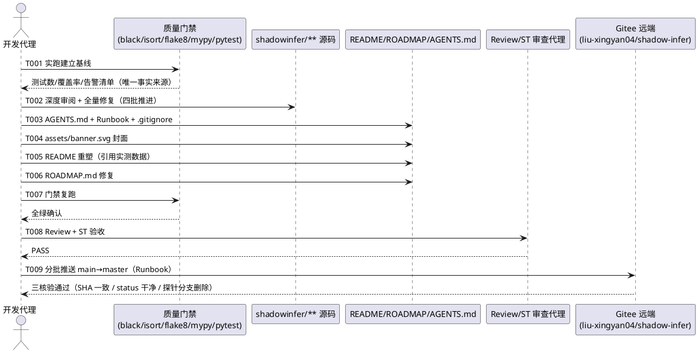

# 1 AR概述

| 组件名称 | ShadowInfer — 面向端侧的 Diffusion LLM 推理优化框架（Python 包 + 配套文档） |
| --- | --- |
| AR系统流水号 | AR001 |
| AR描述 | 代码深度检查与全量修复（五件套门禁实测基线）、README 全方位重塑（中文、无 emoji、实测数据口径）、深色科技风 SVG 封面、关联文档修复（ROADMAP.md / `__init__.py`）、AGENTS.md 流程规则固化（创新→更新 README；AR 完成→推送 Gitee）、AR 完成后首次 Gitee 推送 |

# 2 动态行为

## 交互时序图



# 3 功能点分解

| 序号 | 功能点名称 | 功能点描述 | 追溯 |
| --- | --- | --- | --- |
| 1 | 质量门禁基线 | 实跑五件套，产出测试数/覆盖率/告警清单，作为全文档数据唯一事实来源 | FR3.1 |
| 2 | 代码深度审阅与全量修复 | 审阅范围：shadowinfer/ 全部子包（core/orchestrator/shadowkv/qdrift/ffn_optimizer/kernels/engineering/observability/serving 等）+ tests/ + exporter/ + benchmarks/ + scripts/；修复过期 docstring、死代码、逻辑缺陷、类型与格式问题 | FR3.1、FR3.4（`__init__.py`） |
| 3 | AGENTS.md 流程规则固化 | 写入两条长期规则 + Gitee Push Runbook（适配本仓库）；.gitignore 排除 AGENTS.md 与 .opencode/ | FR3.5 |
| 4 | SVG 封面横幅 | 深色科技风矢量横幅 assets/banner.svg，无 emoji | FR3.3 |
| 5 | README 全方位重塑 | 封面+徽章、结构重组、数据统一、TOC 补齐、架构图重绘、性能基准量化表、Citation/社区章节、版本历史补全 | FR3.2 |
| 6 | ROADMAP.md 修复 | 链接修正、数据口径与实测统一 | FR3.4 |
| 7 | 门禁复跑验证 | 五件套全绿、覆盖率不低于基线 | FR3.1 验收 |
| 8 | Review + ST 验收 | S/D/C 合规检查、README 渲染检查、AGENTS.md 排除验证 | 全 FR 验收 |
| 9 | Gitee 推送 | 向用户索取 token，分批推送 main→master，三核验 | FR3.6 |

# 4 实现设计

## 4.1 功能实现思路

本 AR 的三个核心设计决策与方案对比如下（用户已授权自动化，采用推荐方案）：

### 决策 D1：README 优化策略

**方案 A（原地修补）：** 保留现有 18 节结构，仅修复数据矛盾、TOC、版本历史等问题。
优点：改动小、风险低。缺点：结构层次问题（核心卖点埋在长表格里、性能数据缺位、视觉呈现弱）无法解决；与「全方位优化」诉求不符。

**方案 B（信息架构重设计 + 全文重写，推荐）：** 以「30 秒速览 → 5 分钟上手 → 深度阅读」三层渐进披露重组信息：封面横幅 + 徽章行 + 一句话定位 + 关键指标条（测试数/覆盖率/模块数/最低显存）构成首屏；快速开始前置；算法细节、工程化、生态章节按由浅入深排列；全部数据引用 T001 实测口径。
优点：直击第一印象与可信度两个核心痛点；满足 srs 全部验收标准。缺点：工作量最大。
**对 NFR 的影响：** 无 emoji、中文主体、锚点一一对应均可结构性保证。

**方案 C（中英双语双文档）：** 英文 README.md + 中文 README.zh-CN.md。
缺点：违反 srs「中文主体」已确认决策；双文档维护成本翻倍；当前无国际化贡献者。

**结论：采用方案 B。**

### 决策 D2：封面实现方式

**方案 A（纯手写 SVG，推荐）：** 1200×300 矢量横幅，深蓝黑渐变背景 + 网格与光效线条 + 项目名/副标题文字，系统安全字体栈。
优点：矢量无限缩放、零外部服务依赖、随仓库版本化、GitHub 原生渲染。缺点：需手工调优视觉细节。

**方案 B（在线生成服务，如 shields.io/typing-svg 组合）：** 优点：省时。缺点：依赖第三方可用性与网络（含华为网关出网限制）；风格不可控。

**方案 C（PNG 位图）：** 缺点：非矢量、高分屏发虚、需图像工具链。

**结论：采用方案 A。** 设计规格：背景线性渐变 `#0B1220 → #10192E`，主光效青蓝（`#22D3EE`）与紫（`#8B5CF6`）双色调，细网格线（opacity 0.06），中央偏左主标题「ShadowInfer」（粗体、字距加宽），下方副标题「面向端侧的 Diffusion LLM 推理优化框架」，右下角点缀 KV-cache/调度意象的抽象几何图形（平行四边形堆叠 + 步进曲线）。全文件无 emoji 字符。SVG 根元素声明 `width/height/viewBox`，文字使用 `<text>` + `font-family="Segoe UI, PingFang SC, Microsoft YaHei, sans-serif"`，确保中文回退渲染。

### 决策 D3：代码审计推进策略

**分层过滤法（推荐）：** 先跑五件套获得客观机械问题清单（black/isort/flake8/mypy 输出），再对核心模块人工深审逻辑问题；修复按四批推进——批1 机械格式、批2 类型与告警、批3 逻辑与死代码、批4 文档与注释；每批完成即跑受影响模块的 pytest 子集，T007 全量复跑兜底。避免一次性大改导致回归定位困难。

## 4.2 功能实现设计

### 4.2.1 流程图

```plantuml
@startuml
start
:T001 实跑五件套门禁;
note right: 产出唯一事实来源\n(测试数/覆盖率/告警清单)
:T002 分层过滤审计;
if (发现设计级缺陷\n(需改公开接口)?) then (是)
  :记录到 ROADMAP 待办\n不在本 AR 强改;
else (否)
endif
:T002 四批修复\n(机械→类型→逻辑→文档);
:T003 生成 AGENTS.md\n(规则+Runbook);
:T003 .gitignore 增项\n(AGENTS.md/.opencode/);
:T004 生成 assets/banner.svg;
:T005 重写 README.md\n(方案B信息架构);
:T006 修复 ROADMAP.md;
:T007 五件套复跑;
if (全绿且覆盖率≥基线?) then (否)
  :定位失败项回到 T002 修复;
  detach
else (是)
endif
:T008 Review + ST 验收;
if (PASS?) then (否)
  :按审查意见修复;
  detach
else (是)
endif
:T009 归档 AR;
:T009 向用户索取 token;
:T009 隔离干扰文件;
:T009 构建主题内聚小提交;
:T009 分批推送 main→master;
if (推送成功且三核验通过?) then (否·403)
  :按 Runbook §5 继续对半分批;
  detach
else (是)
else (否·401)
  :向用户索取新 token;
  detach
endif
stop
@enduml
```

### 4.2.2 流程说明

1. **基线先行（T001）**：pytest 计数、覆盖率、四类工具告警全部落档 `specs/changes/AR001-deep-audit-readme/`（进度记录），后续文档一律引用此口径，从源头消除 543/566/581 矛盾。
2. **四批修复（T002）**：批1 black+isort 机械修复（零逻辑风险）；批2 mypy 告警与类型标注（含 `__init__.py` docstring 修复）；批3 人工深审发现的逻辑缺陷、死代码（每处修复需能说明行为变化并跑对应测试）；批4 注释/文档字符串一致性。每批结束运行受影响模块测试子集。
3. **AGENTS.md（T003）**：内容 = 项目概览与开发约定 + 规则一（创新完成→README 全方位更新：特性表/版本历史/基准数据/结构四检查点）+ 规则二（AR 完成→Gitee 推送）+ Runbook 全文适配（仓库改为 `shadow-infer`、本地 main→远端 master 映射、提交信息风格沿用仓库惯例）+ 安全铁律置顶。写入后立即 `git check-ignore AGENTS.md` 验证排除生效。
4. **封面（T004）**：按 D2 规格生成 SVG；校验点：XML 合法、无 emoji、含 viewBox、相对引用路径 `assets/banner.svg`。
5. **README 重塑（T005）**：按方案 B 三层结构重写；性能基准表数据来自 T001 实测 + benchmarks 既有产物；版本历史补 v3.2.0 条目（从 v3.2.1 混入内容中语义归位），并新增 v3.3.0 条目记录本次 AR 变更（版本号同步 pyproject.toml 与 `__version__`）。
6. **复跑与验收（T007/T008）**：五件套全绿后，派发 Review（S/D/C 合规）与 ST（渲染检查、数据一致性抽查、排除验证）。
7. **推送（T009）**：严格按 Runbook：token 仅存于 PowerShell 临时变量；构建主题内聚小提交（docs/code/docs 修复分离）；预估单批 pack ≤40KB 拆分；成功后三核验。

## 4.3 接口描述

本 AR 不新增/修改任何 Python 对外接口。涉及的「接口」均为仓库级契约：

| 接口 | 类型 | 说明 |
| --- | --- | --- |
| `README.md` 目录锚点 | 文档接口 | TOC 锚点与章节标题一一对应，GitHub 渲染可跳转 |
| `assets/banner.svg` | 资源接口 | README 顶部相对引用，矢量渲染 |
| `AGENTS.md` | 代理契约 | 仓库级开发规范；通过 .gitignore 永不入库、永不上传 Gitee |
| Gitee push | 网络接口 | `git -c credential.helper= push $URL main:refs/heads/master`，URL 含 token 仅存临时变量；经代理 `http://proxy.huawei.com:8080` |
| `.gitignore` | 构建配置 | 新增 `AGENTS.md/`、`.opencode/` 排除项 |

## 4.4 代码设计

目录结构影响（`+` 新增、`M` 修改）：

```
ShadowInfer/
├── AGENTS.md                        + 代理契约（gitignore，本地保留）
├── assets/
│   └── banner.svg                   + 封面横幅
├── README.md                        M 全文重写
├── ROADMAP.md                       M 链接与数据口径修复
├── .gitignore                       M 增项
├── pyproject.toml                   M 版本号 3.2.2 → 3.3.0
├── shadowinfer/
│   ├── __init__.py                  M docstring 修复
│   ├── orchestrator.py              M 审计修复
│   ├── core/**                      M 审计修复
│   ├── shadowkv/**                  M 审计修复
│   ├── qdrift/**                    M 审计修复
│   ├── ffn_optimizer/**             M 审计修复
│   └── (kernels/engineering/observability/serving/...) M 审计修复（shadowinfer/ 全部子包，按 T001 告警清单）
├── tests/                           M 审计修复（按 T001 告警清单）
├── exporter/                        M 审计修复（按 T001 告警清单）
├── benchmarks/                      M 审计修复（按 T001 告警清单）
├── scripts/                         M 审计修复（按 T001 告警清单）
└── specs/changes/AR001-deep-audit-readme/   + 过程资产（srs/design/tasks）
```

模块化要点：审计修复不改变模块边界与依赖方向；README 重写不引入新的文档文件（维持「README 唯一主文档」现状）；AGENTS.md 独立于文档体系（不入库）。提交拆分策略：`fix(code): 审计修复` / `feat(assets): 封面` / `docs(readme): 重塑` / `chore(meta): gitignore+版本号` 四个主题内聚提交，天然满足 Runbook 分批尺寸约束。

# 5 重构设计

无代码级重构。README 信息架构重组（方案 B）即本 AR 的结构性重构，重构范围与理由见 4.1 D1。

# 6 测试设计

## 6.1 单元测试（UT）

- 既有 38 个测试文件、全套 pytest 套件是本 AR 的回归安全网：T002 每批修复后跑受影响模块测试子集；T007 全量复跑必须全绿且覆盖率 ≥ T001 基线。
- 修复行为变化处（批3 逻辑修复）必须定位到对应既有测试用例并确认其断言仍通过；若修复使既有断言失效，属于行为变更，回退该修复并转 ROADMAP 待办（srs §3.1 异常处理）。

## 6.2 接口测试

| 接口 | 用例 | 判据 |
| --- | --- | --- |
| Gitee push（成功路径） | 推送后 `ls-remote $URL master` | 远端 SHA == `git rev-parse main` |
| Gitee push（403 拦截） | 按 Runbook §4 决策树抓响应体 | 含 OversizedFiles/netentsec 字样 → 分批重试后成功 |
| .gitignore 排除 | `git check-ignore AGENTS.md .opencode/` | 两路径均被忽略；`git status --short` 不含二者 |
| SVG 资源 | XML 解析 + 内容断言 | 可被 XML parser 解析；不含 emoji 码位；含 viewBox 属性 |

## 6.3 业务场景测试

| 场景 | 用例 | 判据 |
| --- | --- | --- |
| 30 秒速览 | 打开 README 首屏 | 封面、徽章、一句话定位、关键指标条完整呈现 |
| 5 分钟上手 | 按「快速开始」执行安装与示例 | 命令可复制执行；示例代码与实际 API 签名一致 |
| 深度阅读 | 逐个点击 TOC 锚点 | 全部锚点可跳转；无缺章 |
| 数据可信 | README 与 ROADMAP.md 中测试数/覆盖率均与 T001 落档值比对 | 完全一致 |
| 失效引用检索 | 对 ROADMAP.md 与 `shadowinfer/__init__.py` 全文检索已删除文档名（ARCHITECTURE.md / AGENTS.md / TECHNICAL_SPEC.md / ENGINEERING.md，检索范围仅限这两个文件，不涉及 T003 新建的仓库根 AGENTS.md）与错误相对链接（`../README.md`） | 零命中 |
| README 相对链接检查 | 提取 README.md 全部相对链接（assets/banner.svg、ROADMAP.md、LICENSE、configs/ 等）逐一验证目标文件存在 | 全部有效 |
| README 无 emoji | 对 README.md 全文执行 emoji 码位扫描（U+1F300-U+1FAFF 等区段） | 零命中 |
| 版本追溯 | 版本历史 v3.2.0/v3.2.1/v3.2.2/v3.3.0 | 条目连续、内容语义归位正确 |

## 6.4 异常场景测试

| 异常场景 | 处理设计 | 判据 |
| --- | --- | --- |
| pytest 复跑出现失败 | 定位到 T002 对应修复，修复或回退，不进入 T008 | 全绿后才验收 |
| mypy 既有存量错误无法在批2 内消除 | 不引入新错误为底线；存量清单落档 ROADMAP | 存量数不增 |
| Gitee 401 token 失效 | 停止推送，向用户索取新 token | 不重试超 2 次 |
| Gitee 403 且拆无可拆（单文件超限） | 上报用户转非网关网络推送 | 不死循环 |
| Review 提出意见 | 按 Review/ST 审查意见定向修复，修复后重新触发验收 | 复审通过 |
| 推送中断/部分成功 | 以 ls-remote 远端 SHA 为准判定，续推缺失批次 | 三核验通过 |
| SVG 在浅色主题下对比度不足 | 封面自带深色底，不依赖主题 | 渲染正常 |
