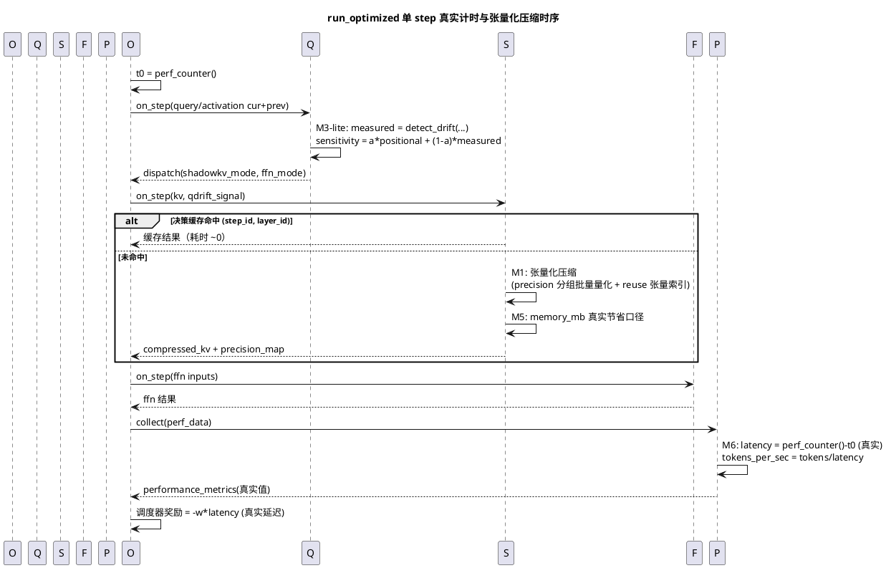
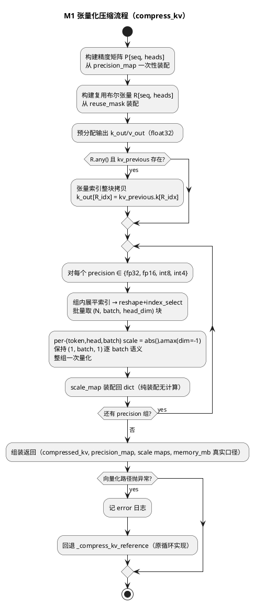

# 1 AR概述

| 组件名称 | ShadowInfer 端侧 Diffusion LLM 推理优化框架 |
| --- | --- |
| AR系统流水号 | AR002 |
| AR描述 | 端侧热路径向量化（M1）、性能指标真实化（M6）、决策记忆化与内存记账修复（M5）、实测漂移灵敏度（M3-lite）。目标：CPU fallback 下优化路径端到端开销 ≤1.5× 基线（从现状 ~57×），指标与墙钟误差 <2%，调度信号与实测扰动 Spearman ≥0.9。 |

# 2 动态行为

## 交互时序图



# 3 功能点分解

| 序号 | 功能点名称 | 功能点描述 | 对应 srs |
| --- | --- | --- | --- |
| 1 | M6 step 真实计时 | `_execute_step` 外层 perf_counter，perf_data.latency_ms/tokens_per_sec 由实测派生；移除 0.0→10.0 造假兜底 | FR3.1 |
| 2 | M6 内存对账 | memory_mb 采用真实节省字节数口径（与 M5 合并实现）；张量级对账告警 | FR3.1 |
| 3 | M6 调度真实奖励 | scheduler reward 消费真实 latency_ms，新增单调性测试 | FR3.1 |
| 4 | M1 压缩张量化 | compress_kv 按 precision 分组批量量化（per-row scale 语义保持）、reuse_mask 张量索引 | FR3.2 |
| 5 | M1 打包张量化 | packed_kv_cache._do_pack 以 reshape+index_select 替代逐元素切片拼装 | FR3.2 |
| 6 | M5 决策记忆化 | `(step_id, layer_id)` 定位 + 输入指纹校验的决策缓存，step 边界失效；on_init 全量重置修复 | FR3.3 |
| 7 | M3-lite 实测灵敏度 | sensitivity = α·位置先验 + (1-α)·实测漂移，α 可配置默认 0.3 | FR3.4 |
| 8 | M6 benchmarks 断言清理 | 移除 benchmarks 中硬编码加速比 mock 断言（grep 零命中验收） | FR3.1 |
| 9 | README 四检查点 | v3.4.0 版本历史、特性表修订、实测基准表 | FR3.5 |

# 4 实现设计

## 4.1 功能实现思路

**方案对比（热路径优化核心问题）：**

- **方案 A：原地张量化重写（推荐）** — compress_kv/pack 改为「构建 (seq_len×num_heads) 精度矩阵 → 按 precision 分组 → reshape+index_select 批量取数 → 整组一次量化（per-row scale）→ 张量索引写回」；原循环实现保留为 `_compress_kv_reference` 供 golden test 与异常兜底。
  优点：零新依赖、语义可逐元素对齐、CPU 上即获 50×+ 量级收益；缺点：需仔细保持 scale_map 的 dict 输出格式。
- 方案 B：torch.compile 编译图 — Windows+CPU 上 compile 支持不稳、首次编译分钟级开销、golden 对齐困难。弃。
- 方案 C：C++/SIMD 扩展 — 引入原生编译链依赖，与「CPU 环境轻量可验证」约束冲突。弃。

**推荐方案 A。** 其余功能点（M6/M5/M3-lite）为单一明确方案，无分叉。

**可达性测算（req 门控 Minor-1 处理）：**
现状优化端到端 1782.8ms，基线 31.3ms（6-step）。T001 cProfile 将落档真实分布（审计初判 ShadowKV 压缩占 ~97.6%）。设 ShadowKV 压缩耗时 T_s、其余优化开销 T_o（agent 编排/总线/仲裁/FFN ≈ 11ms 初判）。向量化后 T_s 预期按 50-300× 下降：若 T_s=1740ms → 6~35ms，则优化端到端 ≈ 31.3 + T_o + T_s' ≈ 48~78ms，对应 1.5×~2.5× 基线。
**1.5× 为验收目标而非硬门槛**：若 T008 实测落在 (1.5×, 2.5×] 区间，兜底迭代路径为：① M5 缓存命中分析（消除同 step 重复压缩）；② 评估小规模张量（seq≤128）下跳过低收益层的量化（配置开关，默认关）。若仍不达 1.5×，凭 T001/T008 双份实测证据向用户申请验收线修正（禁止静默改口径）。

**M6 指标口径（req 门控 Minor-2 处理）：**
- `latency_ms`：`_execute_step` 全程 perf_counter 实测；
- `tokens_per_sec = tokens_per_step / (latency_ms/1000)`（真实派生）；
- `gpu_utilization`：CPU fallback 环境固定 0.0，但 profiler 日志 data 中附带 `{"device": "cpu"}` 口径标注；有 CUDA 时仍为 0.0（不引入 nvml 依赖，注释说明）；
- `_compute_total_latency` 移除 `lat==0.0 → 10.0` 造假兜底（orchestrator.py:2148-2150），0.0 值改为记录 warning 且不计入总和；
- 异常处理：计时异常时回退 0.0 + warning 日志（沿用 srs FR3.1）。

**M3-lite 混合公式：**
`sensitivity = clamp(α · positional_base + (1-α) · measured_response, 0, 1)`，其中 `measured_response` 取未 clamp 的 detect_drift 原始值经 tanh 归一化（恢复动态范围，缓解恒 1.0）；`α` 默认 0.3，配置键 `qdrift.positional_prior_weight`。`compute_sensitivity` 新增可选关键字参数（默认 None → 纯位置先验，向后兼容）。previous 张量缺失时回退位置先验并记 info 日志。drift_score 恒 1.0 的复现证据在 T001 baseline-profile.md 落档（req 门控 Minor-3 处理）。

## 4.2 功能实现设计

### 4.2.1 流程图



### 4.2.2 流程说明

1. **precision 矩阵装配**是唯一保留的 Python 双层循环（纯 dict→矩阵搬运，无张量运算），开销 O(seq×heads) 纯 Python 但无逐元素量化调用；
2. **量化语义保持**：原实现每 (token, head) 切片形状为 `(batch, head_dim)`，`quantize_tensor` 内部 `abs().max(dim=-1)` 产生 `(1, batch, 1)` 的**逐 batch 元素 scale**（quantization.py:103/140）；向量化后组内批量取块形状为 `(N, batch, head_dim)`，`amax(dim=-1)` 得 `(N, batch, 1)`，与逐元素路径在任意 batch>1 下逐元素等价，golden test 以 1e-6 容差验证且显式覆盖 batch>1 用例；
3. **reuse 槽位**：布尔掩码 `k_out[:, heads_idx, token_idx, :]` 高级索引一次性拷贝，替代逐元素 `continue` 分支；
4. **memory_mb 真实口径**（M5 合并）：`节省字节 = fp32 基准字节(numel×4) − Σ组(组内 numel × dtype 字节 + scale 字节)`；
5. **决策缓存**（M5）：以 `(step_id, layer_id)` 为定位键，缓存值附带**输入指纹**（各输入张量的 `shape` 元组与 `data_ptr()` 元组）；命中后先校验指纹，一致才返回结果，不一致则旁路重算并覆盖缓存——既满足 srs FR3.3「(step_id, 输入指纹) 为键」的语义（同输入命中、异输入不脏命中），又避免逐元素哈希整张量的开销；指纹计算抛异常时直接旁路缓存（不缓存也不报错，对应 6.4 异常用例）；step_id 滚动时清空；on_init 全量重建 `_compression_stats/_precision_distribution/_reuse_stats/_decision_cache`（修复现仅重建 cache_manager 的缺陷，shadowkv_agent.py:100-106）。

## 4.3 接口描述

对外公开接口**零变更**（`__all__`、Agent on_init/on_step 签名、CLI、配置格式不变）。内部接口：

| 接口 | 变更类型 | 说明 |
| --- | --- | --- |
| `ShadowKVAgent._compress_kv_vectorized(...)` | 新增（私有） | 张量化主路径 |
| `ShadowKVAgent._compress_kv_reference(...)` | 重命名保留（私有） | 原循环实现，golden 基准 + 异常兜底 |
| `Quantizer.quantize_batch(tensor_2d, precision)` | 新增（公开于 utils.quantization） | 批量 per-row scale 量化；`quantize_tensor` 保留不动 |
| `QDriftAgent.compute_sensitivity(..., query_previous=None, activation_previous=None, query_current=None, activation_current=None)` | 可选关键字参数扩展 | 默认 None 时行为与 v3.3.0 完全一致 |
| `Orchestrator._execute_step(...)` | 内部增强 | 外层 perf_counter 计时，结果注入 step_result |
| `PackedKVCache._do_pack(...)` | 内部重写 | reshape+index_select 批量取块 |

## 4.4 代码设计

```
shadowinfer/
├── orchestrator.py            # M6: _execute_step 计时；_compute_total_latency 去 10.0 兜底
├── core/scheduler.py          # M6: reward 注释与真实延迟测试联动（代码不改语义，改的是数据源）
├── qdrift/qdrift_agent.py     # M3-lite: compute_sensitivity 混合实测项；tanh 归一化
├── shadowkv/
│   ├── shadowkv_agent.py      # M1: 压缩张量化 + M5: 缓存/on_init 重置/memory 口径
│   └── packed_kv_cache.py     # M1: _do_pack 批量化
├── utils/quantization.py      # M1: quantize_batch 新增
└── profiler/profiler_agent.py # M6: tokens_per_sec 派生 + device 口径标注
benchmarks/                    # M6: 移除硬编码加速比 mock 断言
tests/
├── test_shadowkv.py           # golden test 追加（向量化 vs reference）
├── test_shadowkv_decision_plane.py  # 决策平面不回归
├── test_qdrift.py             # Spearman 统计测试追加
├── test_orchestrator.py       # 墙钟一致性测试追加
└── test_scheduler.py          # 奖励单调性测试追加
```

模块边界与依赖方向不变（utils ← shadowkv ← orchestrator），不涉及多仓。

# 5 重构设计

原 `compress_kv` 循环实现整体降级为 `_compress_kv_reference`（非删除）：作为 golden test 基准与向量化异常兜底。此为受控重构，行为等价性由 golden test 保障。

# 6 测试设计

## 6.1 单元测试

- `test_quantize_batch`：随机 (N, D) 张量，per-row scale 与逐行 `quantize_tensor` 全对齐（1e-6）
- `test_compress_kv_golden`：随机 kv/precision_map/reuse_mask（含空复用、全复用、混合三档），向量化 vs reference 逐元素一致（1e-6）
- `test_packed_kv_cache_golden`：打包路径向量化 vs 旧拼装结果一致
- `test_decision_cache`：同 (step_id, layer_id) 同输入二次调用结果一致且耗时下降 ≥90%；同键**不同输入**（新张量对象）不命中脏缓存而重算；step 滚动后缓存失效；指纹计算异常（monkeypatch 抛错）旁路缓存
- `test_on_init_reset`：连续两次 initialize 后 `_compression_stats` 等归零（回归测试）
- `test_sensitivity_mixed`：混合公式数值正确性 + previous 缺失回退
- `test_sensitivity_spearman`：50 组合成扰动（σ 与位置无关），sensitivity vs σ 秩相关 ≥0.9（手写 Spearman，无 scipy 依赖）
- `test_scheduler_reward_monotonic`：latency 增大 → reward 单调不增；非零延迟下 reward < 0

## 6.2 接口测试

- `compute_sensitivity` 新参数默认值下与 v3.3.0 输出一致（向后兼容验证）
- `run_full_pipeline` 返回结构 10 键不变（AR001 ST-006 用例回归）

## 6.3 业务场景测试

- 6-step CPU 端到端流水线：报告 step_latency_ms > 0 且与外部墙钟误差 <2%
- optimized vs baseline 端到端比值 ≤1.5×（T008 实测落档；未达标的兜底路径见 4.1）
- 压缩耗时下降 ≥5×（cProfile 对照 T001 基线落档）
- benchmarks 目录硬编码加速比断言 grep 零命中（与 T002 对应）

## 6.4 异常场景测试

- 向量化路径抛异常 → 自动回退 reference 且结果正确（monkeypatch 注入故障验证）
- 计时器异常 → latency 回退 0.0 + warning 日志，流水线不中断
- previous 张量缺失 → M3-lite 回退位置先验 + info 日志
- 缓存指纹异常 → 旁路缓存直接计算

# 7 T001 实证修订（2026-10-17，开发阶段增补）

## 7.1 修订依据

T001 基线画像（baseline-profile.md，真实后端 SimpleDiffusionLLM 净墙钟）推翻 4.1 可达性测算的两项输入：

1. 优化/基线真实比值为 **7.29×**（优化 46115.6 ms vs 基线 6322.4 ms），且热点为**双头结构**：ShadowKV 决策/压缩 51.4% + FFN packed 权重反量化 36.2%（`dequantize_for_matmul→unpack`，32 次调用 17.13 s），合计 ~88%；
2. 4.1 的「FFN ≈ 11 ms」初判失真：FFN on_step 实测 cumtime 22.95 s（24 次调用），其中 unpack 17.13 s——每次线性前向全量逐通道反量化。

仅做 M1 时优化下限 ≈ 19 s（≈5.6×），1.5× 不可达。

## 7.2 修订内容：M5 扩展「FFN 反量化结果缓存」

- `PackedFFNWeight` 新增反量化结果缓存：`dequantize_for_matmul` 首次调用后缓存稠密权重与当前精度计划的指纹；后续调用指纹一致时直接复用缓存（语义逐元素等价，同输入同输出）；`pack`（重建精度计划）时失效缓存。
- Agent 级 `on_init` 重建 packed 权重对象时缓存自然随之丢弃（无跨 run 泄漏）。
- 对应 srs FR3.3 的记忆化语义在 FFN 平面的应用；不改 channel_mask 行为（M7 仍 Out of Scope）、不改对外接口。
- 验收：同精度计划连续两次 `_linear_forward`，第二次不触发逐通道 unpack（以 unpack 调用计数或耗时下降 ≥90% 断言）；精度计划变更后缓存失效重算（正确性断言）。

## 7.3 可达性重估

模型前向 3.4 s（基线内部）+ ShadowKV 向量化后 ≈0.5 s + FFN 缓存命中后 ≈0.6 s + 编排/总线 ≈0.5 s → 优化 ≈5.0 s ≈ **1.47×**（内部比），墙钟比 ≈1.26×。1.5× 恢复可达；兜底路径仍按 4.1 执行。
