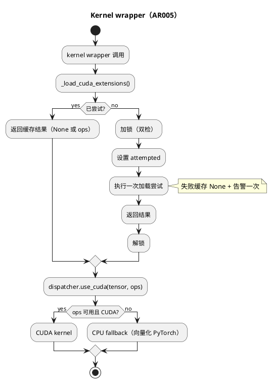
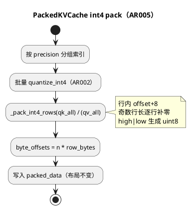

# AR005 Design — 推理管线常数开销消除

## 1 AR概述

| 组件名称 | ShadowInfer / shadowinfer.kernels + shadowinfer.shadowkv.packed_kv_cache |
| --- | --- |
| AR系统流水号 | AR005 |
| AR描述 | 消除 kernel 后端解析的逐次重试与 KV INT4 字节打包的逐条循环；字节布局与数值语义保持 golden 等价。 |

## 2 动态行为





## 3 功能点分解

| 序号 | 功能点 | 描述 | 对应 |
|---|---|---|---|
| 1 | 加载记忆化 | attempted 标志 + 双检锁 + 告警一次 | FR5.1 |
| 2 | INT4 行批量打包 | `_pack_int4_rows`，行内 padding | FR5.2 |
| 3 | 回归测试 | loader 计数/并发/告警一次；pack golden/perf | FR5.3 |
| 4 | 文档版本 | README v3.7.0 + 复现脚本 | FR5.4 |

## 4 实现设计

### 4.1 加载记忆化

```
_cuda_ops = None
_load_attempted = False
_load_lock = threading.Lock()
_warned_no_cuda = False

_load_cuda_extensions():
    if _load_attempted: return _cuda_ops          # 热路径 O(1)
    with _load_lock:
        if _load_attempted: return _cuda_ops      # 双检
        _load_attempted = True
        _cuda_ops = _load_cuda_extensions_once()  # 原加载逻辑
        return _cuda_ops
```

失败分支：`_cuda_ops=None` 被缓存；告警只发一次（`_warned_no_cuda`，加载异常同理由 attempted 保证一次）。

### 4.2 KV INT4 行批量打包

```
rows = quantized.reshape(n, -1)          # [n, batch*groups*group]
offset = (rows + 8).to(uint8)
if cols % 2: pad zero column            # 逐行独立 padding
high = offset[:, 0::2] << 4
low  = offset[:, 1::2] & 0x0F
packed_rows = high | low                 # [n, ceil(cols/2)]
byte_offsets[n] = (n*rb, (n+1)*rb, ...)
```

与参考实现逐位等价证明：
- 参考：每行 flatten → 若奇数补 1 个零 → 顺序两两打包；
- 向量：同一行内同样的 offset/移位/或运算，行间不交叉（padding 列保证偶数）；
- 因此每行字节与拼接顺序完全一致，`cat(rows)` 等于参考 `torch.cat(slices)`。

### 4.3 接口

| 接口 | 签名 | 返回 | 异常/边界 |
|------|------|------|-----------|
| `_load_cuda_extensions` | `() -> Optional[Any]` | 缓存 ops 或 None | 不抛错；失败告警一次 |
| `_load_cuda_extensions_once` | `() -> Optional[Any]` | 单次真实加载 | 捕获异常 |
| `_pack_int4_rows` | `(quantized: Tensor) -> Tuple[Tensor, int]` | `([n, ceil(L/2)] uint8, row_bytes)` | 空张量返回空与 0 |

### 4.4 受影响文件

| 文件 | 变更 |
|---|---|
| `shadowinfer/kernels/__init__.py` | 记忆化 + 双检锁 + 告警一次 |
| `shadowinfer/shadowkv/packed_kv_cache.py` | `_pack_int4_rows` + int4 循环替换 |
| `tests/test_pipeline_overhead.py`（新） | UT-1~UT-6 |
| `README.md` / `ROADMAP.md` / `pyproject.toml` / `__init__.py` | v3.7.0 |

## 5 边界与异常

| 场景 | 期望 |
|---|---|
| CUDA 不可用 | 一次告警，缓存 None，CPU fallback |
| 扩展编译失败 | 一次告警，缓存 None |
| 并发首调用 | 仅一次加载尝试 |
| 空 int4 组 | 跳过，不产生键 |
| 奇数行长 | 行内补零，布局不变 |
| head_dim 非 group_size 整除 | 单组自适应（既有） |
| batch > 1 | 行 = batch×head_dim 展平，布局不变 |

## 6 测试设计

覆盖率目标：当次 `pytest --cov` 实测不低于项目门禁 75%。

| 用例 | 断言 | 对应 |
|------|------|------|
| UT-1 loader 记忆化 | monkeypatch `_load_cuda_ext` 计数；200 次调用仅 1 次尝试 | FR5.1 |
| UT-2 并发首调用 | 8 线程并发，尝试计数 = 1 | FR5.1 |
| UT-3 失败告警一次 | warnings 捕获仅 1 条 | FR5.1 |
| UT-4 pack golden | vec vs `_do_pack_reference`：k/v `torch.equal`、byte_offsets、scales、memory_bytes 一致（seq 7/16，head_dim 16/32，奇数行长） | FR5.2 |
| UT-5 pack 性能 | 128×8×128：3 次中位 vec <= 参考 30% | FR5.2 |
| UT-6 端到端回归 | `run_optimized` 6 步键集合不变、结果可序列化 | FR5.3 |

## 7 决策记录（2026-10-19）

| 方案 | 思路 | 优点 | 缺点 | 结论 |
|---|---|---|---|---|
| A 仅缓存成功 | 保持现状只缓存成功结果 | 改动最小 | 失败环境仍逐次重试（本机 45% 开销） | 弃 |
| B 记忆化 + 批量打包 | attempted 缓存 + 行批量 packing | 消除两类常数开销；golden 可证 | 需处理奇数行 padding | 采用 |
| C 移除 kernel wrapper 直接 CPU | 去掉 kernel 分支 | 简单 | 破坏 GPU 路径与可观测性 | 弃 |
