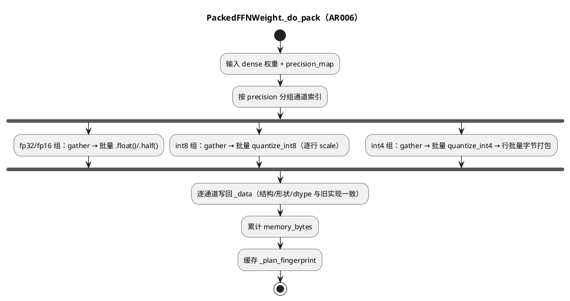

# AR006 Design — FFN 打包冷启动向量化

## 1 AR概述

| 组件名称 | ShadowInfer / shadowinfer.ffn_optimizer.PackedFFNWeight |
| --- | --- |
| AR系统流水号 | AR006 |
| AR描述 | 按精度分组批量打包 FFN 权重；`_data`/字节/内存/指纹与逐通道参考实现逐位一致。 |

## 2 动态行为



## 3 功能点分解

| 序号 | 功能点 | 描述 | 对应 |
|---|---|---|---|
| 1 | 分组打包 | fp32/fp16/int8/int4 批量 gather/量化/写回 | FR6.1 |
| 2 | 字节批量打包 | int4 行内 padding，`_pack_int4_channels` | FR6.1 |
| 3 | 参考实现 | `_do_pack_reference` 保留 golden | FR6.1 |
| 4 | 测试/文档 | golden/性能/接口 + README v3.8.0 | FR6.2/6.3 |

## 4 实现设计

### 4.1 数据结构与布局（不变）

| precision | `_data[ch]` 键 | 形状 |
|-----------|----------------|------|
| fp32/fp16 | `precision`, `tensor` | 展平 `[L]` |
| int8 | `precision`, `q`, `scale` | `q [L]` int8；`scale [1]` |
| int4 | `precision`, `packed`, `scale`, `group_size`, `num_groups` | `packed [ceil(L/2)]` uint8；`scale [1, g, 1]` |

### 4.2 批量算法

```
groups = {precision: [ch...]}
for precision, idx in groups:
    if pack_dim == 0: batch = weight[idx]        # [N, L]
    else:             batch = weight[:, idx].T   # [N, L]
    fp32/fp16: block = batch.float()/half()      # 逐通道 .tensor = block[i]
    int8:  q,s = Quantizer.quantize_int8(batch)  # [N,L],[N,1]
    int4:  q,s = Quantizer.quantize_int4(batch, g)
           packed_rows = _pack_int4_channels(q)  # 行内 padding
    scatter 逐通道写入（保证键/形状/dtype 与旧值一致）
```

对齐要点：
- int8 旧实现 `scale.squeeze(0)` → 每通道 `[1]`；批量为 `[N,1]`，取 `s[i]` 即 `[1]`。
- int4 旧实现 `flat_2d=[1,L]` → `scale [1,g,1]`；批量为 `[N,1,g,1]`，取 `s[i]` 即 `[1,g,1]`。
- int4 字节：旧实现逐通道 `pack_int4`（行内 padding）；`_pack_int4_channels` 等价实现。
- 0 通道：提前返回，`_data={}`、`_memory_bytes=0`、指纹 `()`。

### 4.3 接口

| 接口 | 签名 | 返回 | 异常 |
|------|------|------|------|
| `_do_pack` | `(weight, precision_map, group_size=64) -> None` | 写入 `_data/_memory_bytes/_plan_fingerprint` | 未知精度→fp16 |
| `_do_pack_reference` | 同签名 | golden 逐通道实现 | 同上 |
| `_pack_int4_channels` | `(quantized: Tensor) -> Tuple[Tensor, int]` | `([N, ceil(L/2)] uint8, row_bytes)` | 空输入→`(empty, 0)` |

### 4.4 受影响文件

| 文件 | 变更 |
|---|---|
| `shadowinfer/ffn_optimizer/packed_weight.py` | 分组打包 + 参考实现 + 字节 helper |
| `tests/test_ffn_hotpath.py` | UT-6.1~6.5（含性能用例） |

| `README.md` / `ROADMAP.md` / `pyproject.toml` / `__init__.py` | v3.8.0 |

## 5 边界与异常

| 场景 | 期望 |
|---|---|
| 0 通道 | 空 `_data`，0 字节，指纹 `()` |
| 奇数通道长度（int4） | 行内 padding，`packed` 长度 `ceil(L/2)` |
| channel_len 非 group_size 整除 | 单组（现状） |
| pack_dim=1 | 列 gather 后转置，逐通道写回原形状 |
| 全零通道 | scale=0，保留原值（int8/int4） |
| 未知精度 | fp16 回退 |
| 重复打包 | 覆盖旧 `_data`，指纹/缓存失效（AR004 语义） |

## 6 测试设计

覆盖率目标：当次 `pytest --cov` >= 75%。

| 用例 | 断言 | 对应 |
|------|------|------|
| UT-6.1 golden 混合精度 | `_data` 逐键 `torch.equal`、shape/dtype 一致、`memory_bytes` 一致（pack_dim 0/1） | FR6.1 |
| UT-6.2 奇数长度 int4 | L 奇数时字节/golden 一致 | FR6.1 |
| UT-6.3 空权重 | 空 `_data`、0 字节、指纹 `()` | FR6.1 |
| UT-6.4 unpack 等价 | vec pack 后 `unpack` vs `_unpack_reference` <= 1e-6 | FR6.1 |
| UT-6.5 性能 | 1024×256：3 次中位 vec <= 参考 50% | FR6.1 |
| UT-6.6 回归 | 既有 FFN 测试全通过 | FR6.2 |

## 7 决策记录（2026-10-19）

| 方案 | 思路 | 优点 | 缺点 | 结论 |
|---|---|---|---|---|
| A 保持逐通道 | 仅缓存打包结果 | 零风险 | 冷启动仍随通道线性（7B 约 5s/4 层） | 弃 |
| B 分组批量 + 参考文献 | gather/量化/打包批量，逐通道写回 | 10x 级提升；布局不变；golden 可证 | 需严格对齐 scale/字节形状 | 采用 |
| C 改为统一大张量存储 | 放弃逐通道字典 | 更快 | 破坏兼容与 AR004 缓存语义 | 弃 |
