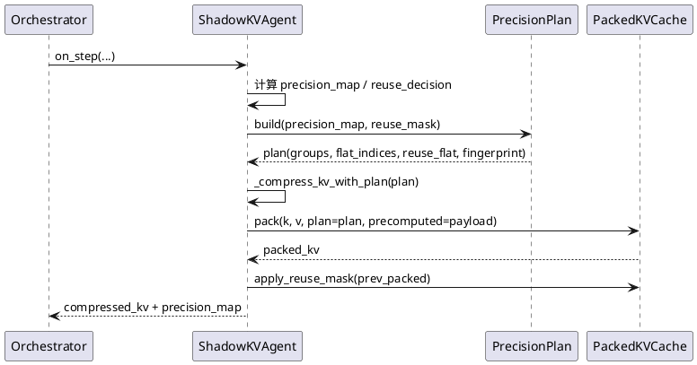
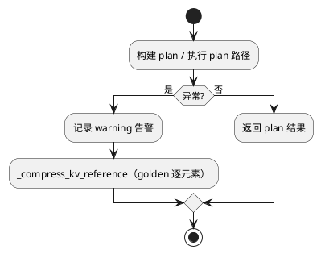
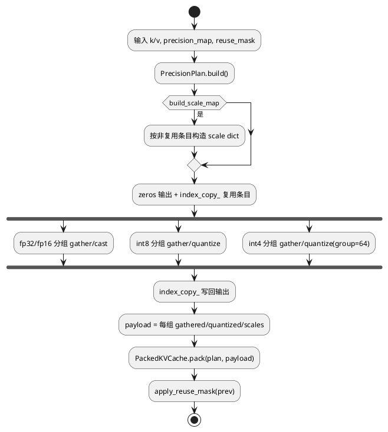

# 1 AR概述

| 组件名称 | ShadowInfer / ShadowKV |
| --- | --- |
| AR系统流水号 | AR008 |
| AR描述 | 借鉴 FlashInfer 的 plan/run 分离思想，引入 `PrecisionPlan`，让 KV 压缩与字节打包共享同一份精度分组/索引/量化结果，消除重复分组、重复 gather 与未使用的 scale dict 构造；保留逐位 golden 与异常回退。 |

## 设计驱动

- 基线：seq=512/heads=8/dim=64 时 compress 21.90 ms + pack 4.35 ms；其中 compress 的 Python 双重循环与逐条 scale 视图占主导，量化仅约 0.14 ms/组。
- FlashInfer 核心参考：先组合元数据（indptr/索引/布局），热路径只做数据面计算；同一计划服务多个阶段。
- 约束：不改存储布局与对外语义；golden 逐位一致；本机仅真实张量微基准。

# 2 动态行为

## 2.1 生产压缩时序



## 2.2 异常回退



# 3 功能点分解

| 序号 | 功能点名称 | 功能点描述 | 追溯 |
| --- | --- | --- | --- |
| 1 | PrecisionPlan | 稠密精度码、分组条目、flat gather 索引、复用索引、fingerprint | FR8.1 |
| 2 | 计划化压缩 | `_compress_kv_vectorized` 消费 plan；生产路径可跳过 scale dict | FR8.2 |
| 3 | 计划化打包 | `PackedKVCache.pack` 消费 plan 与预计算分组，跳过二次分组 | FR8.3 |
| 4 | 生产集成/回退 | `compress_kv` 一次建 plan 贯穿两段；异常回退 reference | FR8.4 |
| 5 | 性能与复现资产 | 多规模微基准、服务器配置、README | FR8.5 |

# 4 实现设计

## 4.1 功能实现思路

采用「计划对象 + 双消费者」方案：

- `PrecisionPlan.build()` 只遍历一次 `(token, head)`，产出：
  - `codes[seq, heads]`（0=fp32,1=fp16,2=int8,3=int4）；
  - `groups[p]`：`(t,h)` 列表，保持 t 升序、h 升序（与旧实现顺序一致）；
  - `flat_indices[p]`：`h * seq + t`，用于对 `[b, h*s, d]` 视图做 `index_select/index_copy_`；
  - `reuse_flat`：复用条目的 flat 索引；仅在 `k_prev` 存在时激活；
  - `fingerprint`：codes + reuse 位图的 SHA-256。
- `_compress_kv_with_plan` 用 flat gather 替代二维 advanced indexing，按分组量化并写回；
  默认 `build_scale_map=True` 保持旧返回结构，生产 `on_step` 传 `False`。
- `_do_pack_with_plan` 直接消费 `plan.groups` 与压缩阶段 gather/量化结果：
  - fp32/fp16/int8：复用压缩阶段的量化结果（同量化器、同输入，逐位一致）；
  - int4：压缩工作副本 group=64，而 `PackedKVCache.pack` 默认 group=16，两套量化
    语义不同，因此只复用 gather 结果，按 pack 的 group size 重新量化，保持旧字节布局；
  - 复用条目仍进入 packed 数据（随后 `apply_reuse_mask` 覆盖），保证缓存完整性。

未引入 plan 的调用路径（公开 `pack`、测试、golden）完全不变。

## 4.2 功能实现设计

### 4.2.1 流程图



### 4.2.2 流程说明

1. `compress_kv` 解析有效 reuse mask（仅 `k_prev` 存在时生效），构建 plan。
2. plan 路径执行压缩；输出 k/v 与 legacy 路径逐位一致：
   - 非复用条目：量化后写回；
   - 复用条目：先写量化值，再由 `k_prev/v_prev` 覆盖（最终值与 legacy 相同）；
   - scale dict（如需）只含非复用条目，键集合与 legacy 一致。
3. 压缩返回 `group_payload`，pack 复用；pack 之后仍调用 `apply_reuse_mask`。
4. 任一步抛错：告警 + `_compress_kv_reference` 回退（不带 payload，pack 走原路径）。

## 4.3 接口描述

```python
# shadowinfer/shadowkv/precision_plan.py
@dataclass
class PrecisionPlan:
    seq_len: int
    num_heads: int
    codes: torch.Tensor                     # [seq, heads] int8
    groups: Dict[str, List[Tuple[int, int]]]
    flat_indices: Dict[str, torch.Tensor]   # h*seq+t
    reuse_entries: List[Tuple[int, int]]
    reuse_flat: torch.Tensor
    fingerprint: str

    @classmethod
    def build(cls, precision_map, seq_len, num_heads, reuse_mask=None,
              device="cpu", strict=True) -> "PrecisionPlan": ...

# ShadowKVAgent
def _compress_kv_vectorized(self, k, v, k_prev, v_prev, precision_map,
                            reuse_mask, plan=None, build_scale_map=True): ...
def compress_kv(self, ..., build_scale_map: bool = True): ...

# PackedKVCache
@classmethod
def pack(cls, k, v, precision_map, group_size=16, plan=None,
         precomputed=None): ...
def _do_pack(self, k, v, precision_map, group_size=64,
             plan=None, precomputed=None): ...
```

兼容性：新增参数均有默认值；`pack`/`compress_kv` 的既有调用与返回结构不变。
私有方法新增 `group_payload` 键仅在 plan 路径出现。

## 4.4 代码设计

```
shadowinfer/shadowkv/
├── precision_plan.py        # 新增：PrecisionPlan
├── shadowkv_agent.py        # compress_kv / _compress_kv_vectorized 接入 plan
└── packed_kv_cache.py       # pack/_do_pack 支持 plan + precomputed
tests/
├── test_kv_plan.py          # 新增：UT-8.1 ~ UT-8.6
└── test_m1_vectorization.py # 既有对照测试须继续通过
specs/changes/AR008-fused-kv-plan/
├── srs.md / design.md / tasks.md
└── ar008_bench.py           # 基线 + legacy/fused 对照微基准
```

模块化要点：
- 计划与数据面解耦：`precision_plan.py` 不依赖 Agent；
- 消费者可选：plan/precomputed 缺省时行为零变化；
- 失败隔离：plan 构建与执行在 `compress_kv` 的 try 内，回退路径完全独立。

# 5 重构设计（可选）

- 将 `_compress_kv_vectorized` 的 plan 分支抽为 `_compress_kv_with_plan`，legacy 分支保持原样以便 golden 对照。
- 将 pack 的 plan 分支抽为 `_do_pack_with_plan`，原 `_do_pack` 不动。

# 6 测试设计

## 6.1 单元测试（UT）

- UT-8.1：plan 分组/索引与旧双重循环逐项一致；fingerprint 稳定且对精度变化敏感。
- UT-8.2：plan 压缩 vs legacy：k/v 逐位一致；scale dict 键与数值一致。
- UT-8.3：`build_scale_map=False`：k/v 与 legacy 一致，返回不含 scale dict 构造副作用。
- UT-8.4：融合 pack vs 旧 pack：`_data` 全键/字节/scale/indices/byte_offsets/memory 逐位一致。
- UT-8.5：复用掩码与 batch>1、奇数 head_dim 边界；复用条目最终值来自 prev。
- UT-8.6：融合路径异常时回退 reference，结果与 legacy 一致。

## 6.2 接口测试

- 现有 `pack`/`compress_kv` 调用签名零改动；默认参数路径回归。

## 6.3 业务场景测试

- `on_step` → 压缩 → pack → store → 下一步复用；`use_packed_cache=True/False` 两种配置。

## 6.4 异常场景测试

- 不支持的 precision：legacy 与 plan 均抛错并回退；
- plan 与张量形状不匹配：明确 `ValueError`，不产生半成品缓存；
- 预计算 payload 缺失：pack 自动回退到自身分组/量化。
