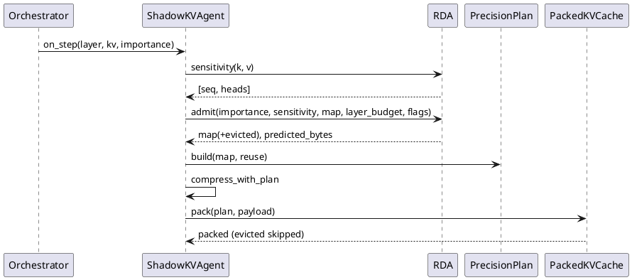
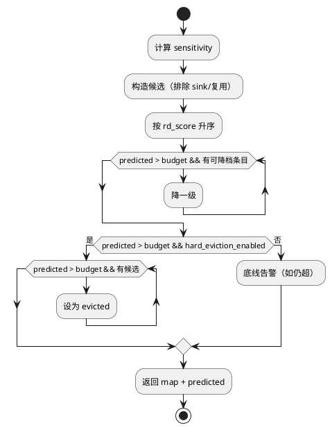

# 1 AR概述

| 组件名称 | ShadowInfer / ShadowKV KV 预算分配 |
| --- | --- |
| AR系统流水号 | AR009 |
| AR描述 | 引入率失真感知的 KV 精度分配与可选硬驱逐：以 `importance × KV 幅值敏感度` 排序，在层预算内降档；预算低于 int4 底线时可驱逐低价值 token-head（零字节），并贯通压缩/打包/解包。 |

# 2 动态行为



# 3 功能点分解

| 序号 | 功能点 | 追溯 |
|---|---|---|
| 1 | KV 敏感度计算 | FR9.1 |
| 2 | RD 排序与降档准入 | FR9.1/9.2 |
| 3 | 可选硬驱逐与保护集 | FR9.3/9.4 |
| 4 | evicted 状态贯通 | FR9.3/9.4 |
| 5 | 基准与复现资产 | FR9.5 |

# 4 实现设计

## 4.1 思路

### 4.1.1 PyramidInfer / FlashInfer 分析结论

- **采用** PyramidInfer 的 heavy-hitter 保留与「预算内少保留低价值 KV」思想；
- **采用** FlashInfer 的 plan/run 与预算内组合（AR008 已完成）；
- **不采用**固定 inverted-pyramid 深度先验：真实模型原型中收益 0-4% 且不稳定，
  改为实测 `importance × sensitivity` 驱动，避免无依据的层偏置；
- 硬驱逐是当前系统缺失的能力：预算低于 int4 底线时原实现只告警不达标。

### 4.1.2 敏感度

`k_absmax = |k|.amax(dim=-1)`、`v_absmax`；`sensitivity = (k_absmax² + v_absmax²) / 2`，
max 覆盖 batch 与 head_dim，输出 `[seq, heads]`。量化误差近似与该值成正比；无需完整量化。

### 4.1.3 分配

候选 = 非 sink、非复用保护的 `(t,h)`，按 `importance × sensitivity` 升序：

1. 逐条按 `fp32→fp16→int8→int4` 降档，直至 predicted ≤ budget；
2. 若仍超预算且 `hard_eviction_enabled`：继续按同序把条目设为 `evicted`（0 字节）；
3. 未启用驱逐则保留 int4 底线并告警（v3.10.0 行为）。

## 4.2 流程图



## 4.3 接口

```python
# shadowinfer/shadowkv/rd_allocator.py
EVICTED = "evicted"
def entry_bytes(precision: str, batch: int, head_dim: int) -> float: ...
def kv_sensitivity(k: torch.Tensor, v: torch.Tensor) -> torch.Tensor:  # [seq, heads]
def admit_budget(importance, sensitivity, precision_map, budget_bytes,
                 batch, head_dim, sink_tokens=0, rd_allocation=True,
                 allow_eviction=False, protected=frozenset()) -> tuple[dict, int, int]: ...

# ShadowKVAgent
def _admit_precision_budget(self, importance_map, precision_map, kv_current,
                            protected=None) -> dict: ...
```

配置：`rd_allocation_enabled`（默认 True）、`hard_eviction_enabled`（默认 False）。

## 4.4 代码设计

```
shadowinfer/shadowkv/rd_allocator.py   # 新增纯函数
shadowinfer/shadowkv/shadowkv_agent.py # 接入、保护集、统计
shadowinfer/shadowkv/precision_plan.py # codes 支持 evicted（4），分组排除
shadowinfer/shadowkv/packed_kv_cache.py# pack 跳过 evicted；evict 不复活
tests/test_rd_allocator.py             # UT-9.x
specs/archive/AR009-rd-kv-allocation/ar009_bench.py
```

`evicted` 语义：
- `entry_bytes=0`，不计入 packed_data；
- `unpack` 输出零（缓存本为零初始化）；
- `PrecisionPlan` 的 `evicted_entries` 单独记录，不进 `groups`；
- 压缩输出对应位置为零；
- `precision_bits["evicted"]=0`。

# 5 重构设计

把 `_entry_bytes` 的成本模型抽到 `rd_allocator.entry_bytes`，Agent 方法委托，避免测试/基准两套口径。

# 6 测试设计

## 6.1 UT
- 敏感度数值与逐条目手算一致；
- RD 排序：同重要性下高幅值保留更高精度；
- 预算合规、只降不升、sink/复用保护；
- RD 关闭时与 v3.10.0 重要性排序一致（golden）；
- 硬驱逐：小预算合规、evicted 不在 packed、unpack 为零、sink/复用不驱逐；
- evicted 经 PrecisionPlan/compress/pack 无异常；再次 evict 不复活；
- 统计：evicted 计 0 bit。

## 6.2 接口测试
- 默认配置（RD on，驱逐 off）与既有 `compress_kv`/`pack` 调用兼容。

## 6.3 业务场景
- `on_step` 小预算 + 复用掩码；`use_packed_cache=True/False`。

## 6.4 异常场景
- 预算非正/未配置：跳过分配；
- sensitivity 形状不匹配：按 seq/heads 最小值裁剪；
- 驱逐全部候选仍超预算：告警并返回底线。
