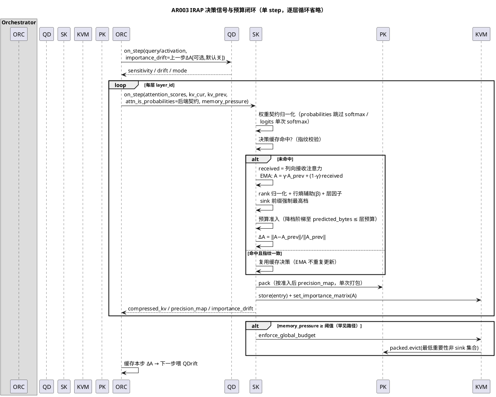
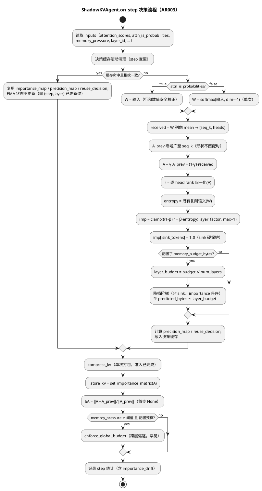

# 1 AR概述

| 组件名称 | ShadowInfer / shadowinfer.shadowkv（决策信号与预算平面）+ orchestrator 接线 + qdrift 可选输入 |
| --- | --- |
| AR系统流水号 | AR003 |
| AR描述 | 修复 ShadowKV 决策平面正确性缺陷（双重 softmax KV-P2、重要性轴向相反 KV-P3、无界历史 KV-P9、预算/驱逐死代码 KV-P4/P8/P10），以 IRAP（跨步 EMA 接收注意力传播）作为统一承载机制，导出 ΔA 差分信号供 QDrift 可选消费。全部验证 CPU-only。 |

# 2 动态行为

## 交互时序图



# 3 功能点分解

| 序号 | 功能点名称 | 功能点描述 | 对应 srs |
| --- | --- | --- | --- |
| 1 | attention 契约显式化 | 输入语义标志（logits/probabilities）+ 单次归一化，双路径（vec/ref）同步 | FR3.1 |
| 2 | 接收注意力重要性轴 | 主信号 = 列向接收注意力（rank 归一化），行熵辅助，sink 前缀硬保护 | FR3.2 |
| 3 | IRAP EMA 传播 | A = γ·A_prev + (1-γ)·received，常数内存状态替代无界 importance_history，形状增广规则 | FR3.3 |
| 4 | 预算准入与全局驱逐 | 预分配降档阶梯（pre-pack）、per-precision 字节估算修正、memory_pressure 消费与跨层驱逐 | FR3.4 |
| 5 | ΔA 信号导出与可选融合 | 步级导出 ‖ΔA‖/‖A‖，orchestrator 一步滞后传 QDrift，默认不融合 | FR3.5 |
| 6 | 公式单源化 | ImportanceModel.score 委托共享向量化核心（消除三份发散拷贝之一） | FR3.2/约束（KV-P7 部分收敛） |

# 4 实现设计

## 4.1 功能实现思路

**统一公式（承载 FR3.1/3.2/3.3）：**

```
权重 W ∈ R^{batch×heads×seq_q×seq_k}：
  attn_is_probabilities=True  → W = 输入（行已归一化，仅数值安全行校正）
  attn_is_probabilities=False → W = softmax(输入, dim=-1)   # 单次，修复 KV-P2

received[t,h] = W[:, h, :, t].mean() ∈ [0,1]                # 列向接收注意力，修复 KV-P3

EMA（IRAP，γ=irap_decay 默认 0.9）：
  A_prev 按新 seq_k 零增广；A = γ·A_prev + (1-γ)·received   # 常数内存，修复 KV-P9

rank 归一化（逐 head 在 token 维）：
  r[t,h] = (argsort(argsort(A[:,h])) + 1) / seq_k ∈ (0,1]

importance = clamp( ((1-β)·r + β·normalized_entropy(W)) · layer_factor, max=1 )
  β = entropy_weight 默认 0.3；sink_tokens 默认 4
  t < sink_tokens → importance[t,h] = 1.0（硬保护，优先于一切降档/驱逐）
```

要点：
- **rank 归一化**而非原始值直用：接收注意力天然长尾（多数 token ≈1/seq），rank 保证档位分布散开（FR3.1 验收「非 fp32 ≥ 50%、档位 ≥ 3」）且与 H2O 的 top-k 语义一致；
- **EMA 在原始空间**进行（可解释、ΔA 有意义），rank 只在分档时刻计算；
- 旧公式的 pos_factor（首 5/尾 5 × 1.2）由 sink 硬保护替代，尾部加成删除（文献无依据，审计 ORC 类批判项）；layer_factor 保留。
- 熵辅助项沿用现有 `Metrics.compute_entropy` 复刻语义（vec/ref golden 的既有口径，不动）。

**预算准入（pre-pack，承载 FR3.4）：**

```
bits(π) = {fp32:32, fp16:16, int8:8, int4:4}
predicted_bytes(π) = Σ_{(t,h)} bits(π[t,h]) · head_dim · 2 · batch / 8   # k+v，修复 KV-P10 的 8x 误差

层预算 layer_budget = memory_budget_bytes // num_layers（配置预算时）
准入：非 sink 条目按 importance 升序逐级降档（fp32→fp16→int8→int4 阶梯，单次排序 O(N log N)），
      直至 predicted_bytes ≤ layer_budget 或全部触底 int4；触底仍超 → log_alert("warning")，保留底线档
memory_pressure ≥ eviction_pressure_threshold（默认 0.9）→ 跨层全局驱逐：
      汇总各层 stored importance 矩阵，按重要性升序选非 sink token-head，
      对属主层调用 packed.evict()（O(全量) 重打包，仅罕见触发路径，可接受），
      直至投影用量 ≤ 预算·0.9（10% 迟滞）或非 sink 全部触底
未配置预算 → 保持现状（无预算动作），pressure ≥ 阈值时告警一次
```

**ΔA 信号（FR3.5）：** `delta_a = ‖A_new − A_prev‖_F / ‖A_prev‖_F`（首步 A_prev 无 → None）；写入返回值 `importance_drift` 与 step custom_metrics。QDrift 侧：`on_step` inputs 新增可选 `importance_drift`，仅当配置 `use_importance_drift=True`（默认 False）时 `_compute_raw_drift` 融合：`raw = (1-w)·raw_qa + w·importance_drift`（w=`importance_drift_weight` 默认 0.3）；默认关闭时 AR002 语义逐位不变。orchestrator 缓存本步 ΔA、下一步传入（一步滞后，避免循环依赖）。

**公式单源化（FP6）：** 共享核心 `compute_irap_importance(...)` 落在 `importance_model.py`（模块级函数，无循环导入）；agent 向量化路径与 `ImportanceModel.score` 均委托；`ImportanceModel._history` 无界 append 一并删除（write-only，无读者）。agent 的 `compute_importance_score` 扩展为逐元素等价参考实现（golden 基准，保留双路径等价口径）。

## 4.2 功能实现设计

### 4.2.1 流程图



### 4.2.2 流程说明

1. **契约归一化**先于一切（含缓存指纹计算之前对输入的读取不变；指纹仍由 (shape,dtype,data_ptr)+标量构成，新增 `attn_is_probabilities` 与 `memory_pressure` 计入指纹标量段——避免缓存跨契约误复用）。
2. **EMA 仅在缓存未命中分支更新**：orchestrator 逐层每 (step,layer) 调用一次，正常路径无命中；测试中重复调用同 (step,layer) 同输入时 EMA 不双重累积（与 AR002「决策缓存二次精确 0」口径一致）。
3. **形状增广**：seq_k 增长 → A_prev 右侧零填充（新 token 的历史从本步起算）；seq_k 收缩 → 截断 + `log_alert("warning")`（异常场景，仅告警不中断）。
4. **降档阶梯在 precision_map 上进行**，压缩打包只执行一次（顺带消除原「先打包再 evict 重打包」的双重量化遍数问题，KV-P6 部分收益）；`packed.evict()` 保留用于罕见全局驱逐路径与 API 兼容。
5. **首步**（`kv_previous` 缺失或 A_prev 缺失）：A = received（EMA 冷启动），ΔA = None，复用决策走既有 no_reuse 分支。
6. **`on_init`**：重置 `_irap_state`/决策缓存（AR002 M4 口径：保留配置、清空状态）。

## 4.3 接口描述

### 4.3.1 ShadowKVAgent

**on_step inputs 新增（可选键，向后兼容）：**

| 键 | 类型 | 默认 | 说明 |
| --- | --- | --- | --- |
| `attn_is_probabilities` | bool | 取 agent 配置同名键（默认 False） | attention 输入语义契约；orchestrator 按后端接线：真实后端（SimpleDiffusionLLM 返回 post-softmax）传 True，mock（randn）传 False |
| `memory_pressure` | float | 忽略（现状） | 已由 orchestrator 传入（orchestrator.py:1361），本 AR 开始消费 |

**config 新增键：**

| 键 | 类型 | 默认 | 校验 |
| --- | --- | --- | --- |
| `attn_is_probabilities` | bool | False | — |
| `irap_decay` | float | 0.9 | (0,1) 开区间，越界 on_init 报 ValueError |
| `entropy_weight` | float | 0.3 | [0,1]，越界报 ValueError |
| `sink_tokens` | int | 4 | ≥0；> seq_len 时全保护 + warning |
| `eviction_pressure_threshold` | float | 0.9 | (0,1]，越界报 ValueError |

**返回值新增：** `importance_drift: Optional[float]`；`irap_stats: {delta_a, gamma, seq_k}`。

**方法签名扩展（关键字参数，默认值保持旧行为语义入口）：**

```python
def compute_importance_score(self, attention_scores, token_index, head_index,
                             layer_index, num_layers, *, attn_is_probabilities=False,
                             received_ema=None, irap_decay=0.9, entropy_weight=0.3,
                             sink_tokens=4) -> float          # 逐元素参考实现（golden 基准）
def _compute_importance_matrix(self, attention_scores, layer_index, num_layers,
                               *, attn_is_probabilities=False, ema_state=None,
                               irap_decay=0.9, entropy_weight=0.3,
                               sink_tokens=4) -> Tensor        # 向量化主路径
```

### 4.3.2 共享核心（importance_model.py，模块级）

```python
def compute_irap_importance(weights: Tensor, received_ema_prev: Optional[Tensor],
                            irap_decay: float, entropy_weight: float,
                            sink_tokens: int, layer_index: int,
                            num_layers: int) -> Tuple[Tensor, Tensor, Optional[float]]
# 返回 (importance_map[seq_k, heads], new_ema[seq_k, heads], delta_a|None)
```

| 参数 | 类型/约束 | 异常/边界 |
| --- | --- | --- |
| `weights` | Tensor，形状 (batch, heads, seq_q, seq_k)，已完成契约归一化（概率） | 含 NaN/Inf：沿用既有 nan_to_num 防御口径（§6.4），不抛异常；shape 维数 ≠ 4 → ValueError |
| `received_ema_prev` | None 或 (seq_k', heads)；seq_k' < seq_k 零增广，> seq_k 截断 + 调用方告警 | None → 冷启动 A = received |
| `irap_decay` / `entropy_weight` | (0,1) / [0,1] | 越界由 agent config 校验前置拦截（on_init ValueError），本函数断言防御 |
| `sink_tokens` | int ≥ 0 | ≥ seq_k 时全保护（调用方已告警） |
| 返回 `delta_a` | float 或 None（`received_ema_prev` 为 None 时） | — |

`ImportanceModel.score` 委托该函数（保持返回 [seq, heads] 的既有契约）；删除其 `_history`。

### 4.3.3 KVCacheManager

| 方法 | 签名 | 说明 | 异常/边界 |
| --- | --- | --- | --- |
| `set_importance_matrix` | `(layer_id: int, importance: Tensor) -> None` | 张量级元数据（替代逐对象 `set_token_head_meta` 的生产调用；后者保留 API 兼容） | importance 形状与既有层不一致 → 覆盖并 `log_alert("warning")`（以最新为准）；layer_id 越界不校验（与既有 store 口径一致） |
| `get_importance_matrix` | `(layer_id: int) -> Optional[Tensor]` | 全局驱逐时读取；未存储层返回 None | — |
| `enforce_global_budget` | `(budget_bytes: int, sink_tokens: int) -> int` | 跨层驱逐（packed.evict 路径），返回驱逐条数 | budget ≤ 0 → 返回 0；无 packed 层 → 返回 0；触底（非 sink 全 evict 仍超）→ 告警并返回实际条数 |

`_enforce_budget` 保留（store 后兜底），字节估算修正为 per-precision bits 口径。

### 4.3.4 QDriftAgent

- `on_step` inputs 新增可选 `importance_drift: Optional[float]`（orchestrator 一步滞后传入）；
- config 新增 `use_importance_drift`（默认 False）、`importance_drift_weight`（默认 0.3，[0,1] 校验）；
- `_compute_raw_drift` 新增可选参数 `importance_drift`：`use_importance_drift=True` 且值合法时 `raw = (1-w)·raw_qa + w·importance_drift`；默认关闭时行为逐位不变（AR002 兼容锚点）。

### 4.3.5 Orchestrator

- `_run_shadowkv`：kv_inputs 新增 `attn_is_probabilities = self._is_real_backend()`（真实后端返回 post-softmax）；`memory_pressure` 传递不变（已存在）；
- `_execute_step`：缓存上一步 shadowkv 聚合的 `importance_drift`，下一步 `_run_qdrift` 的 qdrift_inputs 携带（键 `importance_drift`）。

## 4.4 代码设计

| 文件 | 变更 |
| --- | --- |
| `shadowinfer/shadowkv/importance_model.py` | 新增模块级 `compute_irap_importance`；`ImportanceModel.score` 委托；删 `_history` |
| `shadowinfer/shadowkv/shadowkv_agent.py` | 契约归一化、EMA 状态（`_irap_state: Dict[layer, Tensor]`）、rank+sink 公式、预算准入阶梯、ΔA 导出、`importance_history` 删除、决策缓存指纹扩展、`on_init` 重置 |
| `shadowinfer/shadowkv/kv_cache_manager.py` | `set/get_importance_matrix`、`enforce_global_budget`、`_enforce_budget` 字节估算修正 |
| `shadowinfer/qdrift/qdrift_agent.py` | 可选 `importance_drift` 输入与受控融合 |
| `shadowinfer/orchestrator.py` | 契约标志接线、ΔA 一步滞后传递 |
| `tests/test_irap_contract.py`（新） | FR3.1/3.2/3.3 |
| `tests/test_budget_eviction.py`（新） | FR3.4 |
| `tests/test_importance_drift.py`（新） | FR3.5 |
| `tests/test_m1_vectorization.py` 等 | 旧公式绝对值断言按新公式修订（附根因注释） |

**测试影响面（预期内破坏性变更）：** 旧重要性语义断言（熵饱和塌缩、pos_factor 1.2 首 5 位、双重 softmax 数值）需同步修订——修订限于 tests/，每处附根因说明（srs §5 假设已覆盖）；vec/ref golden 等价断言（≤1e-6）双路径同步变更后继续成立。

# 5 重构设计

1. `importance_history: Dict[layer, List[Tensor]]` → `_irap_state: Dict[layer, Tensor]`（O(1) 常数内存，KV-P9）；
2. 决策公式三份发散拷贝（agent vec / agent ref / ImportanceModel）收敛为共享核心 + golden 参考（KV-P7 部分收敛；`KVDecisionPlane` 接线留 AR005）；
3. 驱逐元数据从逐 `TokenHeadScore` 对象（Python 循环构造）转为张量级矩阵（热路径零对象构造）；
4. 降档时机从「打包后 evict 重打包」前移至「precision_map 准入」（消除双重量化遍数，KV-P6 部分收益）。

# 6 测试设计

覆盖率目标：不低于 AR002 口径 81.68%（pytest --cov，门禁 fail-under 75）。

## 6.1 单元测试（UT）

| 用例 | 断言 | 对应 |
| --- | --- | --- |
| UT-1 契约-概率输入 | 已归一化输入 + 强非均匀接收注意力构造 → 非 fp32 档占比 ≥ 50% 且档位种类 ≥ 3；修复前同构造全 fp32（对照断言反转） | FR3.1 |
| UT-1b 行和安全校正 | 概率契约下行和非 1 输入（数值扰动构造）→ 校正后重要性与严格归一化输入 ≤ 1e-6 | FR3.1 边界 |
| UT-2 契约-logits 输入 | logits 输入下单次 softmax 中间权重与旧实现 bitwise 一致（中间量 golden） | FR3.1 |
| UT-3 契约-默认告警 | 配置缺失 + 概率输入但默认 logits 假定 → log_alert("warning") 一次 | FR3.1 异常 |
| UT-4 sink 反转 | sink 模式 attention（首 token 接收最高、行熵最低）→ sink token 档位 = 最高（修复前为最低，对照断言） | FR3.2 |
| UT-5 轴向正确性 | 全序列档位与列向接收注意力 Spearman ≥ 0.9；高频被引用 token 档位严格高于低接收对照组 | FR3.2 |
| UT-6 EMA 等价 | 增量 EMA vs 全量加权重算 `Σγ^(t-i)(1-γ)·received_i`，max\|Δ\| ≤ 1e-6 | FR3.3 |
| UT-7 常数内存 | 200 步后 `_irap_state` 元素数不随步数增长（对象级断言：与首步同形） | FR3.3 |
| UT-8 EMA 冷启动/增广 | 首步 A=received；seq 增长零填充正确；seq 收缩告警不中断 | FR3.3 异常 |
| UT-9 参数校验 | γ∉(0,1)、β∉[0,1]、sink<0、阈值∉(0,1] → ValueError | 接口边界 |
| UT-10 vec/ref golden | 新公式下向量化 vs 逐元素参考 max\|Δ\| ≤ 1e-6（含概率/logits 两契约、sink 边界） | NFR |
| UT-11 准入阶梯 | 小预算下 predicted/stored bytes ≤ 层预算；降档按重要性升序、逐级（fp32→fp16→int8→int4）；sink 不降 | FR3.4 |
| UT-12 字节估算 | 修正后估算 vs 实测 packed memory_bytes 误差 ≤ 2%（scale 字节计入） | FR3.4 |
| UT-13 触底告警 | 全 int4 仍超预算 → log_alert("warning")，保留底线档不丢 sink | FR3.4 异常 |
| UT-14 全局驱逐 | pressure ≥ 0.9 触发跨层驱逐；非 sink 最低重要性先驱逐；驱逐后投影 ≤ 预算·0.9；sink 存活；修复前同构造为空操作（对照断言）；`enforce_global_budget` 返回驱逐条数 > 0 且与元数据标记一致；`get_importance_matrix` 未存储层返回 None | FR3.4 |
| UT-15 未超阈稳定 | pressure < 阈值 → 无任何降档/驱逐动作 | FR3.4 |
| UT-15b 无预算默认路径 | 未配置 memory_budget_bytes + pressure ≥ 阈值 → 无任何降档/驱逐动作，仅 log_alert("warning") 一次（默认配置回归锚点） | FR3.4 边界 |
| UT-16 ΔA 单调 | 构造突变幅度 0.1/0.5/2.0 → delta_a 严格单调递增；首步 None | FR3.5 |
| UT-17 QDrift 默认关 | use_importance_drift=False → drift_score 与不传 importance_drift 逐位一致 | FR3.5 兼容 |
| UT-18 QDrift 融合开 | 开启后 raw = (1-w)·raw_qa + w·delta，方向正确；非法值忽略 + warning | FR3.5 |
| UT-19 单源化 | ImportanceModel.score 与 agent 向量化结果 ≤ 1e-6；`_history` 不再累积 | FP6 |
| UT-20 决策缓存-EMA | 同 (step,layer) 重复调用 → 决策命中且 EMA 状态不变（不双重累积） | 4.2.2 点 2 |

## 6.2 接口测试

- on_step 新增输入键缺省时行为 = 修复前默认路径（向后兼容冒烟）；
- 返回值新字段（importance_drift / irap_stats）存在性与类型；
- set_memory_budget 运行时改预算后准入阶梯按新预算生效；
- config 合法边界值：β=0（纯 rank）/ β=1（纯熵）/ sink_tokens=0（无保护）行为符合定义（UT-9 的合法侧补充）；
- orchestrator ΔA 一步滞后语义：step t 的 shadowkv 输出 importance_drift 在 step t+1 的 `_run_qdrift` inputs 中可见（键 `importance_drift`），step 0 为 None。

## 6.3 业务场景测试

- 多步 E2E（mock 后端，randn=logits 契约）：预算开启，20 步跨层累计字节 ≤ 全局预算，ΔA 进入 step metrics；
- 真实后端路径（SimpleDiffusionLLM post-softmax=概率契约）：档位分布散开、无熵饱和塌缩（对 FR3.1 的后端级验证）；
- AR002 口径复测：E2E 3 次中位 ≥ 1.4x、全量回归不回退。

## 6.4 异常场景测试

| 场景 | 期望 |
| --- | --- |
| attention 含 NaN/Inf | 既有防御路径处理，不崩溃（nan_to_num 前置校验维持） |
| seq 收缩 | 截断 + warning，继续执行 |
| kv_previous 缺失首步 | A=received、ΔA=None、no_reuse（既有分支） |
| 预算触底（全 int4 仍超） | warning，保留底线档，不静默丢 sink |
| sink_tokens ≥ seq_len | 全保护 + 配置告警 |
| 决策缓存指纹异常（data_ptr 读取抛异常） | 旁路缓存（不命中不写入，AR002 语义维持） |
| memory_pressure 非法（负数/None/NaN） | 忽略 + warning，不触发动作 |

# 7 决策记录（2026-10-17，设计阶段）

**核心方案对比（重要性信号与历史机制）：**

| 方案 | 思路 | 优点 | 缺点 | 结论 |
| --- | --- | --- | --- | --- |
| A 最小修复 | 修 softmax 契约 + 轴向（每步全量列向计算），历史截断为窗口 N=5 | 改动最小 | 历史 O(N·S·H)；跨步信息丢弃；无 ΔA；无机制承载，创新性弱 | 弃 |
| B IRAP 统一机制 | 列向 EMA 状态 + rank 归一化 + sink 保护 + 预算准入 + ΔA 导出 | 常数内存、增量计算、跨步稳定、为 AOG/宏块率控（AR005/AR006）铺路；单一机制承载全部 FR | 中等工作量；双路径 golden 维护 | **采用** |
| C 决策平面全量重构 | 三份拷贝 + KVDecisionPlane 全部统一到 IRAP 平台 | 彻底收敛 KV-P7 | 范围爆炸、风险高、阻塞正确性修复交付 | 部分采纳（仅 ImportanceModel 委托，DecisionPlane 留 AR005） |

**关键子决策：**
1. 契约显式标志 vs 自动检测（行和≈1 判概率）：**显式标志**——自动检测在数值扰动/极端分布下不确定，违背确定性测试原则；
2. 预算准入 pre-pack（precision_map 降档）vs post-pack（evict 重打包）：**pre-pack**——单次打包、O(N log N)、顺带消除双重量化遍数（KV-P6 部分收益）；post-pack 路径仅保留为罕见全局驱逐；
3. rank 归一化 vs 原始值/分位数截断：**rank**——对长尾分布稳健、保证档位散开（直接满足 FR3.1 验收）、与 H2O top-k 语义同族；
4. 降档阶梯（逐级）vs 直落 int4：**阶梯**——同预算下保留更多信息（质量更优），实现同为单次排序；
5. 删除 pos_factor 尾部加成：文献无依据（审计批判项），sink 硬保护已覆盖前缀；保留 layer_factor（层深度语义有据）；
6. ΔA 一步滞后传递 vs 同步注入：**滞后**——shadowkv 在 qdrift 之后执行，同步需重排执行序（影响面大）；滞后一步无信息损失（ΔA 本身是跨步量）。

**用户指示对齐：** 本 AR 需求/设计阶段不做收益实验；T007/T008 按规则 1.1 执行（≥3 次重复中位、多规模、统计/golden 证据落档）。

**srs 同步记录（设计门控第 1 轮）：** srs §3.3/§3.4 三处措辞已按本设计修订对齐——① 驱逐复杂度口径（常态 O(选中集合) pre-pack / 罕见 O(全量) 全局驱逐）；② 元数据接口（张量级 set_importance_matrix，对象级 API 保留兼容）；③ EMA 状态无需持久化标量统计（rank 归一化在分档时刻进行）。
